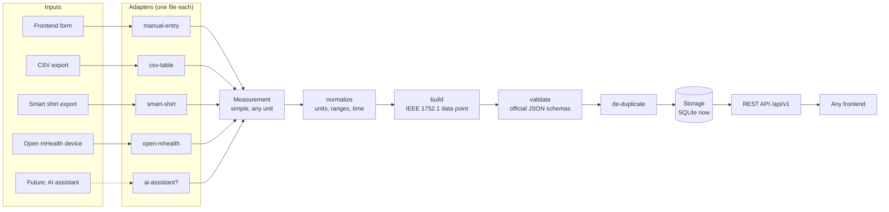

# Backend Architecture — Ingestion & Normalization

How to run it is in [README.md](README.md); how the team connects to it is in [INTEGRATION.md](INTEGRATION.md).

## 1. The one-sentence version

Every input, whatever its format, is turned into the same simple **Measurement** by a small
**adapter**. One shared **pipeline** then converts units, checks the values, builds a standard
**IEEE 1752.1 / Open mHealth data point**, checks it against the official schema, and stores it.
Frontends only ever talk to a documented JSON API.

## 2. The layers, and the one rule between them

| Layer | Folder | Knows about | Never knows about |
| --- | --- | --- | --- |
| **API** | `app/api/` | HTTP, request/response | units, schemas, SQL |
| **Adapters** | `app/adapters/` | one input format | the standard, the database |
| **Pipeline** | `app/pipeline/` | the steps, in order | HTTP, which device sent it |
| **Domain** | `app/domain/` | metrics, units, data models | HTTP, database, files |
| **Standards** | `app/standards/` | official JSON schemas | everything else |
| **Storage** | `app/storage/` | how data is saved | HTTP, adapters |

**The rule:** each layer only calls the layers below it, and the domain depends on nothing.
That is what lets you swap pieces: a new frontend touches nothing here; Postgres instead of SQLite
means writing one new storage class; a new device is one new adapter file.

## 3. Key decisions and why

**Adapters produce `Measurement`s, not standard data points.**
A `Measurement` is flat and forgiving: `metric`, `value`, `unit` (any spelling), `time` or
`start`/`end`. The standard's nested structure lives in exactly one place (`pipeline/build.py`).
So whoever writes an adapter only has to understand their device, not IEEE 1752.1. This is also
what makes the future AI step easy: a language model is much more reliable at producing a flat
`Measurement` than a nested standard document, and its output goes through the same checks as
everything else (see §6).

**We use the IEEE 1752.1 header, not the old Open mHealth one.**
While building this I found Open mHealth deprecated its own `header` and `data-point` schemas in
June 2026 in favour of IEEE 1752.1. The body schemas (heart rate, blood pressure...) are still
Open mHealth's and already reference IEEE building blocks, so we're on the current standard.

**Who/which-device lives outside the standard data point.**
The IEEE 1752.1 header has no user or device field. So each stored record is an envelope
(`subject_id`, `device_id`, `adapter_id`, `ingestion_id`, flat `values`) around the untouched
standard `data_point`. You can always export pure standard data, and the analysis layer gets an
easy flat `values` column.

**Everything is checked against the official schemas, offline.**
`scripts/fetch_schemas.py` bundles all 37 official schemas (plus everything they reference) into
the repo. Every data point is validated against them before storage. This makes "standard
compliant" a tested fact, not a claim, and it works with no internet: relevant for a spacecraft.

**Ranges catch typos, not illness.**
Each metric has a physically possible range (heart rate 20–250, etc.). A reading outside it is
rejected as a likely typo or sensor fault. Deciding what is *worrying* (e.g. resting HR up 15%) is
the analysis layer's job, kept separate on purpose.

**One bad record never sinks the batch.**
Every rejected record comes back with where it was (`row 3 / systolic`) and why, and the rest is
stored. Unrecognised columns are reported as warnings, never guessed.

**Re-sending data is safe.**
Each data point's id is computed from its content (subject + device + metric + the source's own id,
or time + values). Sending the same file twice stores nothing new and reports duplicates.
Useful for store-and-forward sync later, where re-sends are normal.

**The raw payload is kept.**
Every ingestion saves the original input. If an adapter improves, old data can be re-processed.

**Custom metrics follow the standard's own extension pattern.**
Open mHealth has no HRV, mood or radiation schema, so they are defined in our own `astro`
namespace using the same conventions and IEEE building blocks (`app/standards/schemas/astro/`).

## 4. What's built so far

- 10 metrics: heart rate, blood pressure, body temperature, blood glucose, SpO2, breathing rate,
  sleep duration (Open mHealth); HRV, mood, radiation dose (`astro`).
- 4 adapters: `manual-entry` (forms), `csv-table` (spreadsheet exports, recognises common column
  names), `smart-shirt` (simulated Astroskin-style export, with device quirks like 0–1 SpO2),
  `open-mhealth` (devices that already speak the standard).
- Unit conversion: °F/K to °C, mmol/L to mg/dL, kPa to mmHg, fraction to %, minutes/seconds to
  hours, µSv/Sv to mSv, plus common spellings (`bpm`, `°F`, `mmol/l`...).
- REST API with auto-generated interactive docs at `/docs` (frontend devs can try every endpoint
  there without reading code).
- 47 automated tests, including one that runs every adapter's example through the full pipeline.

## 5. Known limits (on purpose, for now)

- **No login/auth yet.** Anyone who can reach the API can write data. Needed before real use.
- **SQLite** is fine for one machine. Postgres is a new class implementing `storage/base.py`.
- **The smart-shirt format is our own stand-in**, modelled on what Bio-Monitor records, not the
  vendor's real file format.
- **CSV doesn't do sleep yet**, because sleep needs a start and end, not one timestamp.
- **The `astro` schema URLs use a placeholder domain** (`tylanauts.example`). Fine offline; would
  need a real address to publish them.

## 6. Where the next pieces plug in

- **AI-assisted entry** = one more adapter. It sends free text / a photo of a reading to a
  language model, asks for a list of `Measurement`s (the JSON shape is
  `Measurement.model_json_schema()`), and yields them. Validation, ranges and schema checks all
  apply unchanged, so a wrong AI guess is rejected with a reason like any typo.
- **AI column mapping for CSVs**: the "ignored unrecognised columns" warning is exactly where a
  model could *propose* a mapping for a person to confirm, which then gets added to `COLUMNS`.
- **Analysis / correlations / alerts**: read the flat `values` per subject and metric over time
  (`GET /subjects/{id}/data-points`), e.g. personal-baseline z-scores .
- **Store-and-forward sync**: the content-based ids already make re-sends harmless.
